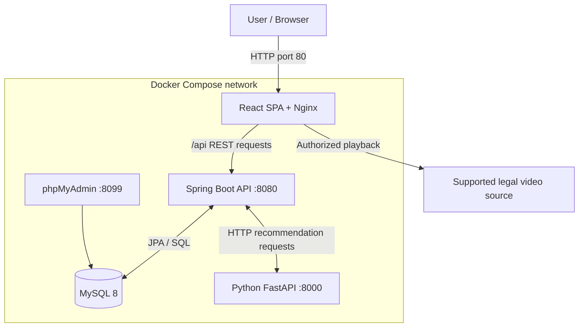
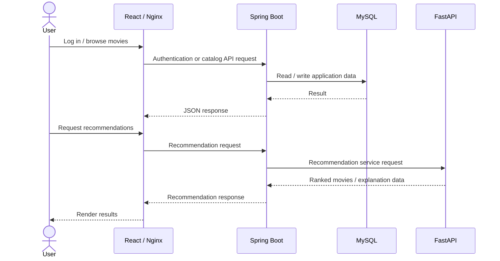
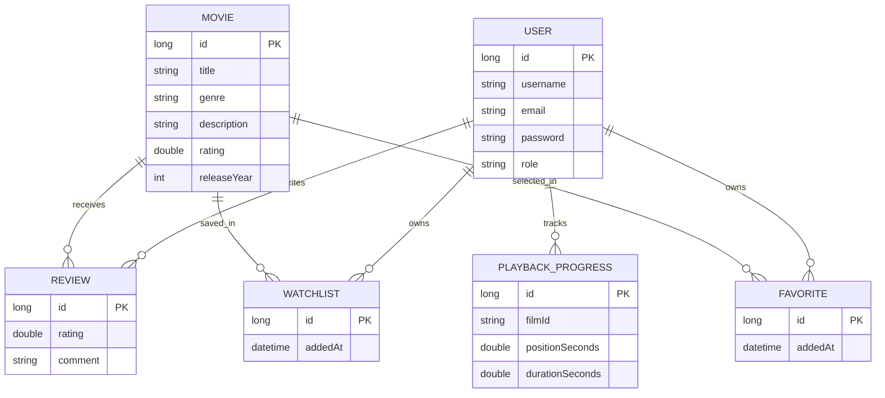
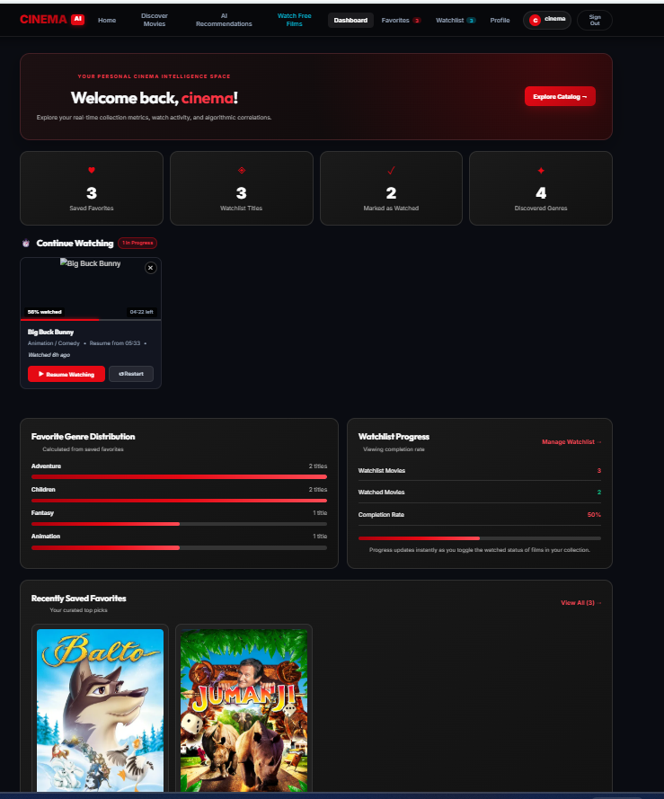
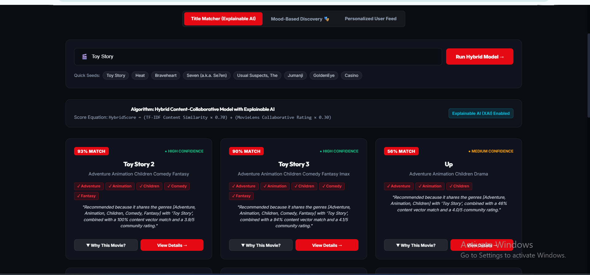
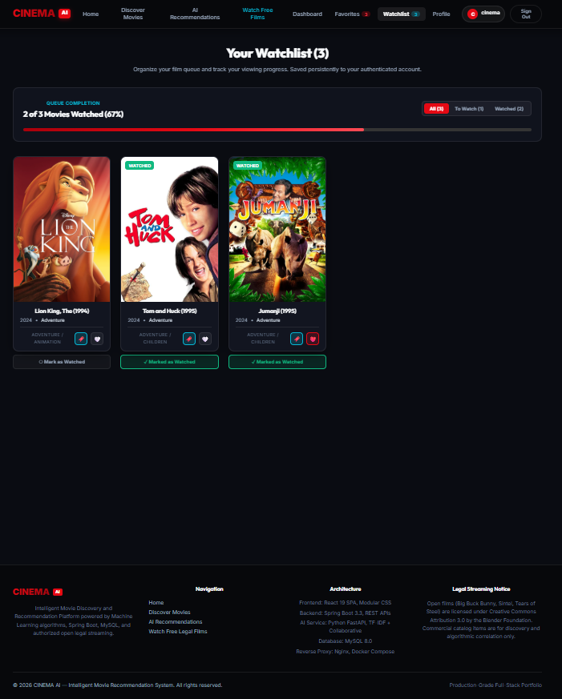
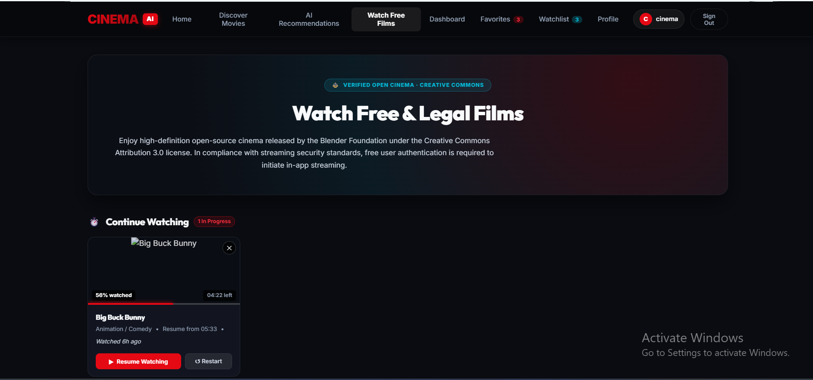

# 🎬 CINEMA AI — Intelligent Movie Recommendation System

**A Dockerized full-stack movie discovery, recommendation, and authorized-streaming application.**

Built with **React**, **Spring Boot**, **Python/FastAPI**, **MySQL 8**, and **Nginx**. This documentation was prepared by inspecting the supplied project archive, not just from a feature wish list.

> **Verification:** Local frontend tests **11/11**, backend tests **52**, and AI tests **5** were reported passing in October 2026; the React production build compiled successfully. These are local test results, not a claim of public production readiness.

## ✨ Features

- **Authentication:** Account registration, login, JWT-based request authentication.
- **Movie discovery:** Catalog browsing, movie search, poster images, genres, release years, and movie details.
- **Recommendations:** Hybrid movie recommendation service, mood-based recommendations, and recommendation explanations.
- **Reviews:** Movie ratings, reviews, rating summaries, and review-management endpoints.
- **Personal lists:** Watchlist and favorites backed by persistent records.
- **Authorized video streaming:** Legal-film catalog and an authorization endpoint for supported streams.
- **Continue Watching:** Saved playback progress, resume, restart, and removal of progress.
- **Profile and administration:** User profile endpoints; admin endpoints for users, movies, reviews, legal films, analytics, and audit logs.
- **User experience:** Loading skeletons, toast notifications, and movie-detail dialogs.

> Availability and access to specific features depend on user role, backend configuration, and the available catalog. Streaming authorization does not confer rights to arbitrary commercial movies.

## 🏗️ System Architecture



### Services and local ports

| Service | Implementation | Host port | Container/service name |
|---|---|---|---|
| Web | React SPA served by Nginx | `80` | `frontend` / `movie_frontend_service` |
| Backend | Spring Boot REST API | `8090` → `8080` | `backend` / `movie_backend_service` |
| AI | FastAPI recommendation service | `8000` | `ai-service` / `movie_ai_service` |
| Database | MySQL 8 | `3306` | `mysql-db` / `movie_recommendation_db` |
| Database UI | phpMyAdmin | `8099` → `80` | `phpmyadmin` / `movie_phpmyadmin` |

Docker Compose connects the containers using the `movie_network` bridge network and persists MySQL data in the named `mysql_data` volume. The Compose file defines health checks for MySQL and the AI service.

### Request flow



## 🧠 AI Recommendation Design

The supplied Python implementation includes:

1. **TF-IDF content representation:** `TfidfVectorizer(stop_words="english")` processes the movie `content` column.
2. **Cosine similarity:** Scores similarity between movies based on their content vectors.
3. **Rating-derived collaborative signal:** The recommender calculates the mean MovieLens rating for a candidate movie and normalizes it by dividing by 5. **This is a movie-level rating signal, not user-user or item-item collaborative filtering.**
4. **Hybrid ranking:** The source code computes `hybrid_score = 0.7 × content_similarity + 0.3 × normalized_average_rating`.
5. **Explainability:** `RecommendationExplainer` constructs metadata to help explain recommendations.
6. **Mood-based discovery:** Separate mood recommendation logic and supported-mood endpoints.
7. **Sentiment:** An AI endpoint accepts review text and returns a predicted sentiment.

**Implementation caveat:** The hybrid function uses movie content similarity plus average community ratings. Describe this precisely during interviews rather than claiming a fully personalized collaborative-filtering model without further evidence.

### AI API endpoints

| Method | Path | Purpose |
|---|---|---|
| `GET` | `/health` | AI service health check |
| `POST` | `/recommend` | Movie-title-based recommendations; JSON body contains `movie_title` |
| `POST` | `/sentiment` | Review sentiment; JSON body contains `review` |
| `GET` | `/moods` | List supported moods |
| `GET` | `/mood-recommendations?mood=...&limit=12` | Mood-based recommendations |

FastAPI interactive documentation is typically available at **http://localhost:8000/docs** while the service is running.

## 🗃️ Data Model (High-Level)

The Java entity classes define `User`, `Movie`, `Review`, `Watchlist`, `Favorite`, `PlaybackProgress`, and `AdminAuditLog`.



This is a **simplified conceptual ER diagram** derived from Java entity fields, not a database-exported physical schema. Playback progress refers to legal-film identifiers (`filmId`), rather than necessarily referencing the `Movie` table.

## 🔌 Backend API Overview

Representative controller route groups found in the Java source:

| Base route | Responsibility |
|---|---|
| `/api/auth` | Register and login |
| `/api/movies` | Catalog, movie lookup, search, reviews, rating summaries |
| `/api/recommendations` | Recommendation and mood functionality |
| `/api/streaming` | Legal catalog and stream authorization |
| `/api/playback-progress` | Saved playback positions |
| `/api/watchlist` | Personal watchlist |
| `/api/favorites` | Favorites |
| `/api/reviews` | Review actions and statistics |
| `/api/users` | Profile and user actions |
| `/api/admin` | Administrative operations |
| `/api/v1/health` | Backend health endpoint |

**Note:** Some routes require authentication or admin privileges. Inspect controller method annotations and DTOs for exact request bodies, authorization rules, and HTTP methods.

## 📂 Repository Structure

```text
Movie-recommendation-ai/
├── ai-service/
│   ├── api/                  # FastAPI application
│   ├── recommendation/       # TF-IDF, hybrid, mood recommenders
│   ├── explainable_ai/       # Explanation generation
│   ├── sentiment/            # Sentiment analysis
│   ├── evaluation/           # Evaluation artifacts
│   ├── notebooks/            # Exploration and experiments
│   └── tests/
├── backend/
│   ├── src/main/java/movieai/
│   │   ├── config/
│   │   ├── controller/
│   │   ├── dto/
│   │   ├── entity/
│   │   ├── repository/
│   │   ├── security/
│   │   └── service/
│   └── pom.xml
├── frontend-app/
│   ├── public/
│   ├── src/
│   │   ├── components/
│   │   ├── context/
│   │   ├── services/
│   │   └── __tests__/
│   └── package.json
├── datasets/
├── database/
│   ├── migrations/
│   ├── analytics/
│   └── backups/
├── deployment/
│   └── docker/
├── tests/
│   ├── api/
│   ├── performance/
│   └── system/
├── .env.example
└── docker-compose.yml
```

## 🚀 Installation and Running

### Prerequisites

- Docker Desktop with Docker Compose
- Git (if cloning from a repository)
- Node.js/npm (optional, for running frontend tests/build locally)

### 1. Prepare configuration

Open a terminal in the project root, where `docker-compose.yml` is located. Copy `.env.example` to `.env` and configure credentials for your environment.

**Security warning:** The Compose configuration currently contains fallback database credentials (e.g., `moviepass` and `root_password`) intended for local development. **Change these before exposing the project beyond your own machine.** The supplied `.env.example` also lists `JWT_SECRET`; confirm that the backend actually receives and uses the configured value before deployment.

### 2. Start services

```bash
docker compose up -d --build
docker compose ps
```

Open:

- **Application:** http://localhost
- **Backend:** http://localhost:8090
- **AI:** http://localhost:8000
- **AI docs:** http://localhost:8000/docs
- **phpMyAdmin:** http://localhost:8099

### 3. Useful Docker commands

```bash
# Logs
docker compose logs -f backend
docker compose logs -f ai-service
docker compose logs -f frontend

# Rebuild the frontend only
docker compose up -d --build --no-deps frontend

# Stop without deleting named volumes
docker compose down
```

Do **not** use `docker compose down -v` unless you intend to remove the named MySQL data volume.

## 🧪 Tests and Build

### Frontend

```bash
cd frontend-app
npm install
npm test -- --watch=false --runInBand
npm run build
```

From the repository root, `npm run build` also invokes the frontend build.

### Observed local results (October 2026)

| Check | Result |
|---|---|
| React automated tests | **11 / 11 passed** in 3 suites |
| Spring Boot tests | **52 passed** |
| Python AI tests | **5 passed** |
| React production build | **Compiled successfully** |
| Docker Compose | **5 containers running** |
| MySQL and AI health checks | **Healthy** |
| Login / registration | **Manually verified** |

**68 automated tests passed** across these application areas. The React test runner also reported a non-failing Jest open-handles warning. End-to-end coverage, security testing, and deployment hardening remain separate tasks.

## 📸 Screenshots

Add actual screenshots to `docs/screenshots/` and replace these placeholders:

```markdown




```

## 🔐 Security and Legal Content

- JWT authentication and authorization are implemented in the backend; review role checks and security filters before public release.
- Only stream content you have permission to distribute or access.
- Never commit real `.env` files, secrets, or database dumps containing personal information.
- Review exposed database and administration ports, CORS, token handling, and default credentials before deployment.

## 🗺️ Possible Next Improvements

- Add browser-based end-to-end tests for registration, login, recommendations, watchlists, and playback.
- Strengthen security configuration and production secret management.
- Measure recommendation quality with reproducible offline evaluation.
- Add CI checks for all three services, observability, and deployment documentation.
- Capture real application screenshots and a short demo video.

## 🎓 What This Project Demonstrates

**Full-stack engineering · REST APIs · JWT authentication · relational data modeling · Python ML integration · Docker Compose · automated testing · debugging · technical documentation**

---

*Documentation derived from the supplied source archive. Exact runtime behavior may differ with configuration, dataset contents, and deployment environment.*
